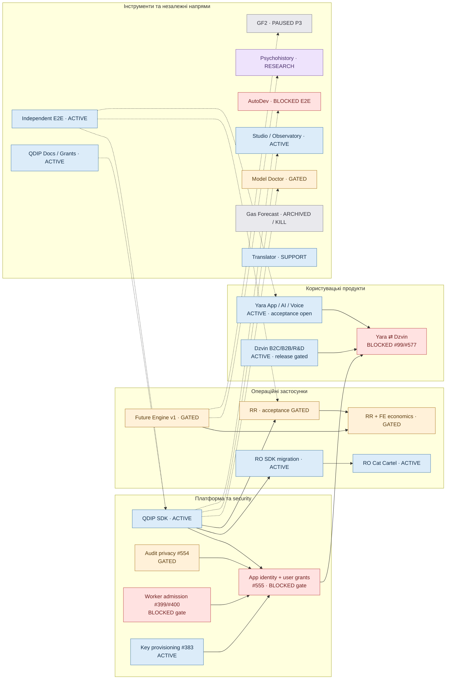

# QDIP Portfolio — залежності, статуси та наступні кроки

> **Знімок стану: 27.10.2026.** Це навігаційна карта портфеля, **не** другий канонічний roadmap і **не** живий deployment/status monitor. Вказані стани походять із пов'язаних GitHub roadmap/issues та перевірених злиттів; «код змерджено», «розгорнуто» і «production E2E PASS» — різні факти. При зміні стану оновлювати саме джерело (issue) і після цього цю карту.
>
> **Легенда:** 🟦 ACTIVE — можна розробляти зараз; 🟧 GATED — реалізація/деплой частково є, повне приймання відкрите; 🟥 BLOCKED — конкретну інтеграцію/функцію не запускати до prerequisite PASS; 🟪 RESEARCH — автономне дослідження, не production-функція; ⏸️ PAUSED — відкладено пріоритетом; ⚫ ARCHIVED — завершено/kill.

## Схема залежностей

Стрілка `A --> B` означає: **B використовує результат A або не може перейти до зазначеної інтеграційної стадії без перевіреного A**. Пунктир — можлива цінність/паралельний трек, **не** релізний блокер усього продукту.

## Статуси та наступна конкретна дія

| Напрям / продукт | Стан | Наступна дія | Від чого залежить / першоджерело |
|---|---|---|---|
| **QDIP Core / SDK-01/02/03** | 🟦 ACTIVE / release GATED | Закрити app identity + per-user delegation, додати версіоновані приватні read-контракти; кваліфікувати реальний зовнішній шлях | [#555](https://github.com/qdip-ai/qdip-core/issues/555), [#404](https://github.com/qdip-ai/qdip-core/issues/404) |
| **SDK audit / Worker trust / credentials** | 🟥 BLOCKED для сторонніх / cross-app даних | Закрити приватність Mongo/events #554, admission/revocation #400, artifact provenance #399, автоматичні credentials #383; негативні E2E | [#554](https://github.com/qdip-ai/qdip-core/pull/554), [#400](https://github.com/qdip-ai/qdip-core/issues/400), [#399](https://github.com/qdip-ai/qdip-core/issues/399), [#383](https://github.com/qdip-ai/qdip-core/issues/383) |
| **Yara App** | 🟦 ACTIVE, acceptance 🟧 | Реальні два акаунти, Google OAuth/readback/write confirmation і iPhone Safari E2E; звірити актуальні PR | [#126](https://github.com/qdip-ai/qdip-personal-secretary/issues/126), [Yara roadmap](https://github.com/qdip-ai/qdip-personal-secretary/blob/dev/docs/VHV_ROADMAP.md), [#71](https://github.com/qdip-ai/qdip-personal-secretary/issues/71) |
| **Yara Voice + Yara AI** | 🟦 ACTIVE | Перевірити UA ASR corpus, error/retry UX і повний voice/text → typed intent → підтверджений результат | [Voice roadmap](https://github.com/qdip-ai/qdip-personal-secretary/blob/dev/docs/YARA_VOICE_ROADMAP.md), [AI roadmap](https://github.com/qdip-ai/qdip-personal-secretary/blob/dev/docs/YARA_AI_ROADMAP.md), [#126](https://github.com/qdip-ai/qdip-personal-secretary/issues/126) |
| **Dzvin.co B2C** | 🟦 ACTIVE, release 🟧 | Завершити check-in → корисна дія → добровільна оцінка → progress; реальне Zitadel/BFF E2E і release | [#482](https://github.com/mentality-prj/mentality-web/issues/482), [#547](https://github.com/mentality-prj/mentality-web/issues/547), [#445](https://github.com/mentality-prj/mentality-web/issues/445) |
| **Dzvin.co B2B + R&D** | 🟦 Створення продукту/пропозиції; protected access 🟥 | Перевірити backend build, індекси, реальні форми/pipeline; окремо tenant isolation/roles перед відкриттям компаній | [#445](https://github.com/mentality-prj/mentality-web/issues/445), [#548](https://github.com/mentality-prj/mentality-web/issues/548), [#549](https://github.com/mentality-prj/mentality-web/issues/549) |
| **Yara ⇄ Dzvin.co** | 🟥 BLOCKED саме data exchange | Спочатку SDK #555/#554/#399/#400 E2E. Потім: календар Yara → Dzvin; фідбек у Dzvin; потім похідні planning preferences → Yara з окремою згодою | [Yara #99](https://github.com/qdip-ai/qdip-personal-secretary/issues/99), [Dzvin #577](https://github.com/mentality-prj/mentality-web/issues/577) |
| **RR / Readiness Recovery** | 🟧 E2E частково PASS; production NOT QUALIFIED | Закрити реальний Zitadel + org-key операторський шлях, потім production business acceptance; не плутати з 11/11 synthetic-session E2E | [#274](https://github.com/qdip-ai/qdip-core/issues/274), [Web #296](https://github.com/qdip-ai/qdip-web/issues/296) |
| **RR → SDK Worker migration** | 🟦 ACTIVE, cutover 🟥 | Довести окремий Worker REGISTER + parity + негативні E2E; тільки тоді вимикати embedded RR | [#453](https://github.com/qdip-ai/qdip-core/issues/453), [#444](https://github.com/qdip-ai/qdip-core/issues/444) |
| **RO / Route Optimizer SDK** | 🟦 ACTIVE, E2E 🟧 | Після автономної видачі credentials довести реальний Worker REGISTER → independent caller → manifest/replay; прибрати дублікати лише після безпечного cutover | [#418](https://github.com/qdip-ai/qdip-core/issues/418), [PR #551](https://github.com/qdip-ai/qdip-core/pull/551) |
| **RO CC · Cat Cartel** | 🟦 Гра розвивається; real optimizer 🟥 | Захищений серверний RO adapter + порівнянний baseline + real E2E; незалежно можна удосконалювати карту/UX, TLS | [Cat #3](https://github.com/qdip-ai/ro-cat-cartel/issues/3), [Cat #7](https://github.com/qdip-ai/ro-cat-cartel/issues/7) |
| **Future Engine v1** | 🟧 DEPLOYED, E2E OPEN; feature-freeze | Авторизований forecast → SEALED artifact → read/replay та Mongo recovery; без нових FE v1 features | [#275](https://github.com/qdip-ai/qdip-core/issues/275) |
| **FE-04 + RR Economics** | 🟧 MERGED/DEPLOYED, бізнес-evidence OPEN | Production tenant-positive E2E; отримати реальні дані про витрати запасів/закупівель, перевірити ефект проти baseline | [#505](https://github.com/qdip-ai/qdip-core/issues/505), [#491](https://github.com/qdip-ai/qdip-core/issues/491) |
| **Model Doctor** | 🟧 Робочий browser; release security / external MCP OPEN | Independent adversarial review, rollback; окремо реальний ChatGPT OAuth → MCP tools/list/call E2E | [#24](https://github.com/qdip-ai/qdip-model-doctor/issues/24), [#26](https://github.com/qdip-ai/qdip-model-doctor/issues/26), [#6](https://github.com/qdip-ai/qdip-model-doctor/issues/6) |
| **AutoDev + Mission Control** | 🟥 End-to-end BLOCKED; code ACTIVE | **Один** Issue #388 → durable dispatch/Copilot → independent verifier → реальний Draft PR через кнопку; не створювати другу архітектуру | [#354](https://github.com/qdip-ai/qdip-core/issues/354), [#469](https://github.com/qdip-ai/qdip-core/issues/469) |
| **QDIP Web / Studio / Observatory** | 🟦 ACTIVE; частина операцій gated | Довести live RR operator auth; відкривати сторонні плагіни тільки після admission + ownership; не використовувати спільний root key для приватних клієнтів | [Web #296](https://github.com/qdip-ai/qdip-web/issues/296), [Core #400](https://github.com/qdip-ai/qdip-core/issues/400) |
| **QDIP E2E** | 🟦 Незалежний інструмент | Підтвердити live Zitadel/real provider paths окремо від synthetic sessions; доповнити 2-user/3-app negative security gate | [qdip-e2e](https://github.com/qdip-ai/qdip-e2e) |
| **Psychohistory / Future Engine R&D** | 🟪 RESEARCH ACTIVE | Сформувати нові preregistered перевірювані механізми на чесному at-risk dataset, зберегти sealed holdout, отримати незалежний прогноз/abstention | [#448](https://github.com/qdip-ai/qdip-core/issues/448), [#461](https://github.com/qdip-ai/qdip-core/issues/461) |
| **GF2 (нова газова програма)** | ⏸️ PAUSED P3 | Не починати другий FE; після acceptance FE v1 — оцінити migration #255 і PIT readiness, тільки потім новий прогнозний цикл | [#181](https://github.com/qdip-ai/qdip-core/issues/181), [#255](https://github.com/qdip-ai/qdip-core/issues/255) |
| **Gas Forecast (стара програма)** | ⚫ ARCHIVED / KILL 2026-09-23 | Зберігати негативні результати й reproducibility; не просувати як комерційний продукт | [Research closure](https://github.com/qdip-ai/qdip-core/blob/dev/docs/research/gas-forecast-closure-2026-09-23.md) |
| **Translator** | ⏸️ SUPPORT / no active product gate verified | Підтримувати українсько-польську модель; нові локалізації тільки після виміряної потреби | [translator repo](https://github.com/mentality-prj/mentality-translator) |
| **QDIP Docs / Grants** | 🟦 ACTIVE SUPPORT | Актуалізувати технічні evidence links, заповнювати прогалини TRL/LOI для grant і investor diligence; не переносити непідтверджені claims | [Grant evidence pack](https://github.com/qdip-ai/qdip-docs/blob/main/docs/grant-evidence-pack/README.md) |

## Жорсткі залежності (не плутати з паралельною розробкою)

1. **Yara ⇄ Dzvin.co LIVE:** `SDK app identity + owner authorization + per-user delegated scopes + audit minimization + admission gates + negative E2E PASS` **AND** `Yara calendar identity/refresh acceptance` **AND** `Dzvin privacy/release controls`.
2. **RO SDK cutover:** independent Worker credentials / authenticated REGISTER / replay / negative E2E PASS **перед** вимкненням legacy.
3. **RR SDK cutover:** Worker parity + real customer/operator route + negative E2E PASS **перед** видаленням embedded RR.
4. **Cat Cartel real RO label:** trusted private solver adapter + comparable baseline + exact-scenario real E2E; гра без справжнього RO може розвиватися незалежно.
5. **FE-04 economic claims:** реальна історія використання/замовлень + порівняння з baseline; сам deployed API не доводить грошей.
6. **Doctor → external ChatGPT:** успішна окрема інтерактивна OAuth/MCP перевірка, не лише browser login.
7. **AutoDev READY:** підтверджений один реальний Issue → independently verified Draft PR, без фальшивого DONE.

## Рекомендоване управління портфелем

- **Одне головне P0 вузьке місце:** SDK app/user data boundary + worker admission. Його вирішення відкриває взаємодію продуктів і сторонніх розробників, але не зобов'язує зупиняти незалежний розвиток Yara чи Dzvin.
- **Незалежно паралельно:** Yara calendar/voice QA, Dzvin B2C value/release, RR/RO migration E2E, AutoDev one-click vertical slice; Doctor security acceptance.
- **Не розширювати зараз:** GF2 (P3), старий Gas Forecast (KILL), некваліфіковані marketing/AI claims та нову SDK/Worker/Gateway архітектуру.
- **Правило оновлення:** одна зміна статусу = посилання на тест/PR/deployment або явний user decision; лише після цього статус у цій карті змінюється. Відсутність evidence ≠ PASS.

**Поточний roadmap є навігаційним snapshot; release, issue та production decisions завжди перевіряти за linked canonical source.**
